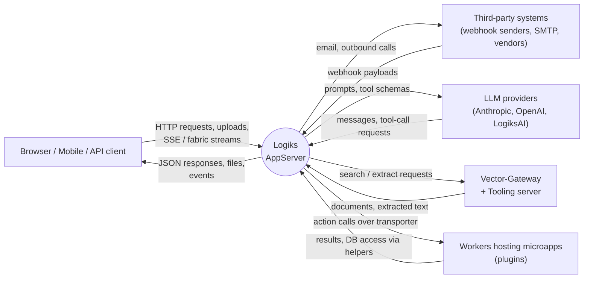
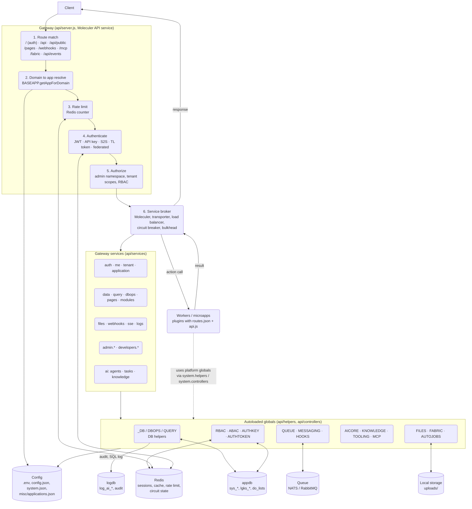
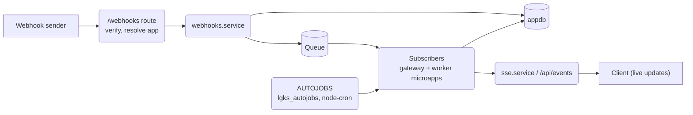
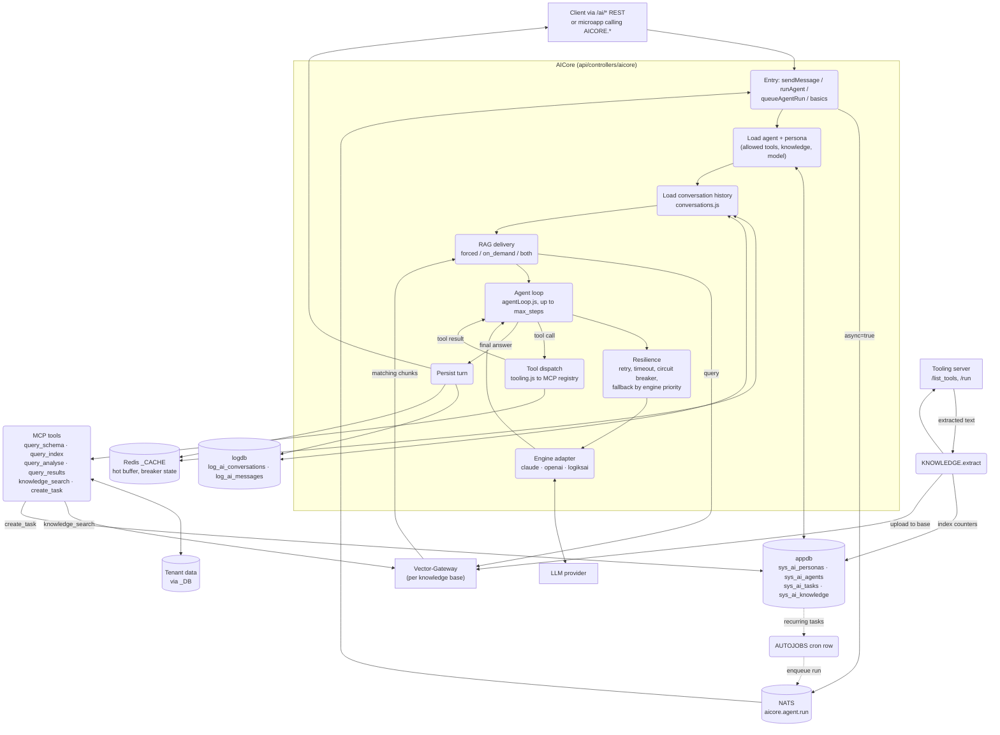
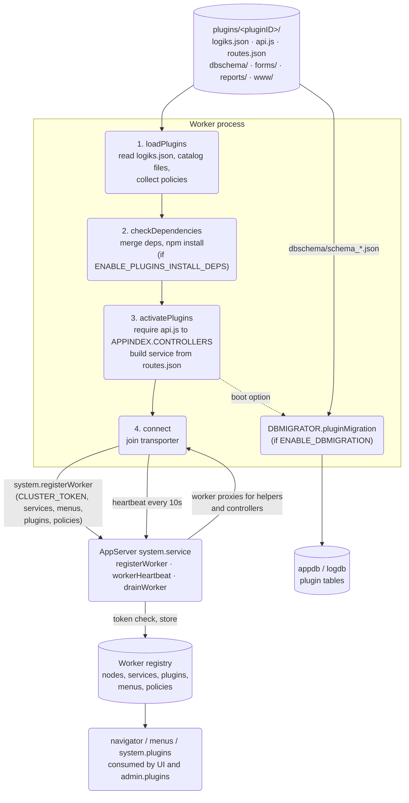
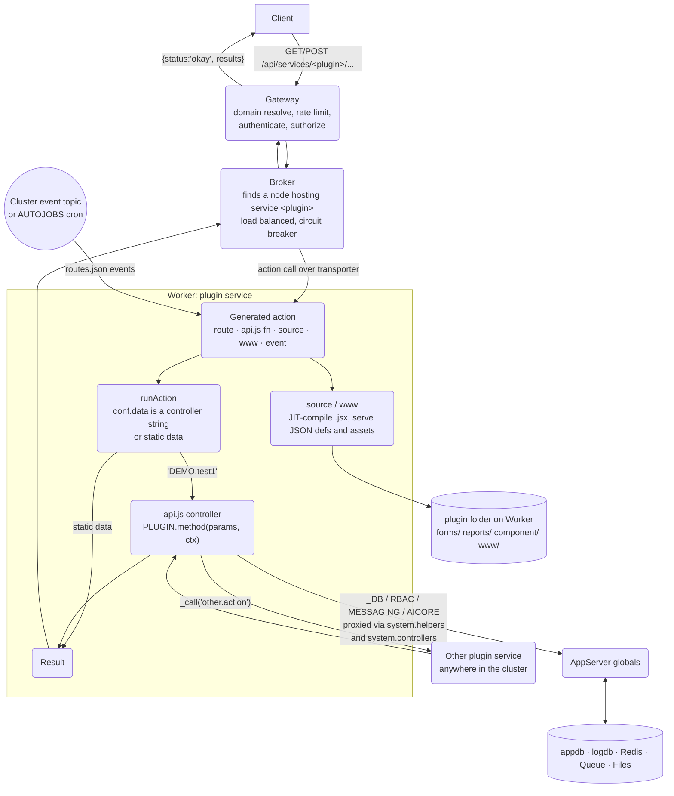

# Data Flow Diagram

How data moves through the AppServer. Sources: [api/server.js](../api/server.js), [api/baseapp.js](../api/baseapp.js), [api/controllers/aicore/](../api/controllers/aicore/), [docs/05-workers.md](05-workers.md), [docs/09-ai-layer.md](09-ai-layer.md).

Legend: rectangles are external entities, rounded boxes are processes, cylinders are data stores.

## Level 0: context

## Level 1: request path and platform stores

## Level 1: webhook and event paths

## Level 2: AI layer (AICore, the 4th tier)

## Level 2: plugin (microapp) flow

Plugins live in a Worker's `plugins/` folder (Microapps-Worker-NodeJS repo), not in this repo. This repo is the gateway that routes to them and the cluster registry that tracks them. See [docs/04-microapps.md](04-microapps.md).

### Startup: how a plugin becomes a service

### Runtime: a request to a plugin

## Notes

- Services and controllers read and write both databases only through the `_DB` helper family, which picks a driver (MySQL, PgSQL, MSSQL, MongoDB, DynamoDB, DuckDB) from config.
- Workers do not get a separate data path to clients. All client traffic goes through the gateway, which forwards the action call over the transporter and returns the result.
- The `local_worker` AI lane ([api/workers/aiagent.worker.js](../api/workers/aiagent.worker.js)) isn't shown because nothing dispatches to it yet.
